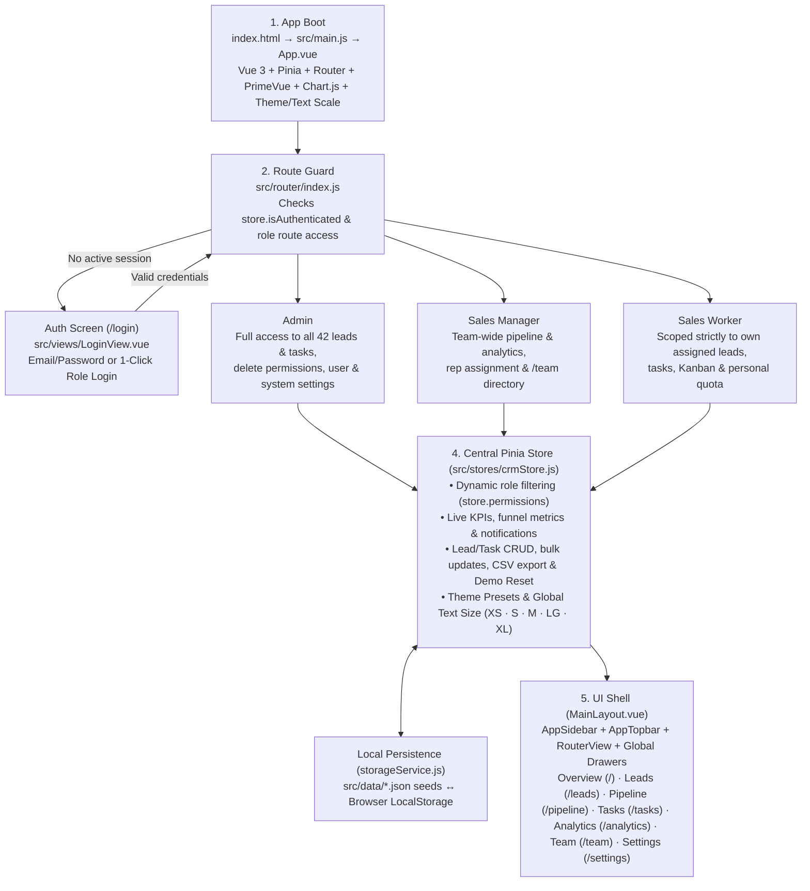

# PulseCRM — Vue 3 + PrimeVue CRM Lead Management Dashboard (JavaScript Edition)

A modern, responsive SaaS **CRM Lead Management Dashboard** built in **100% pure JavaScript (ES Modules)** with **Vue 3 (`<script setup>`)**, **Vite**, **PrimeVue 4 (`@primeuix/themes/aura`)**, **PrimeIcons**, **Tailwind CSS v4**, **Pinia**, **Vue Router**, and **Chart.js (`vue-chartjs`)**.

---

## Project Architecture & Developer Flowchart

Visual diagrams are included in [`docs/pulsecrm-flowchart.svg`](docs/pulsecrm-flowchart.svg) and [`docs/pulsecrm-flowchart.png`](docs/pulsecrm-flowchart.png).



---

## Key Features

- **Role-Based Authentication (`Admin`, `Sales Manager`, `Sales Worker`):** Instant role session switching and scoped data visibility persisted in `LocalStorage`.
- **Global Dashboard Text Size (`XS`, `S`, `M [Default]`, `LG`, `XL`):** Scales every heading, table header/row, sidebar link, KPI metric, badge, button, form drawer, and Chart.js canvas axis/legend/tooltip smoothly from both **Settings** and the **Topbar Appearance Popover**.
- **Interactive Analytics & Kanban Pipeline:** 7-stage drag-and-drop Kanban board, Chart.js data visualizations, multi-criteria filtering, bulk actions, and CSV export.

---

## Quick Start (Run on `localhost`)

```bash
# 1. Install dependencies
npm install

# 2. Start local dev server
npm run dev
```

Open **`http://localhost:5173`** in your browser.

---

## Demo Login Accounts

| Role | Name | Email | Password |
| :--- | :--- | :--- | :--- |
| **Admin** | Elena Rostova | `elena.rostova@pulsecrm.io` | `Admin@123` |
| **Sales Manager** | Marcus Vance | `marcus.vance@pulsecrm.io` | `Manager@123` |
| **Sales Worker** | Sofia Alvarez | `sofia.alvarez@pulsecrm.io` | `Worker@123` |
